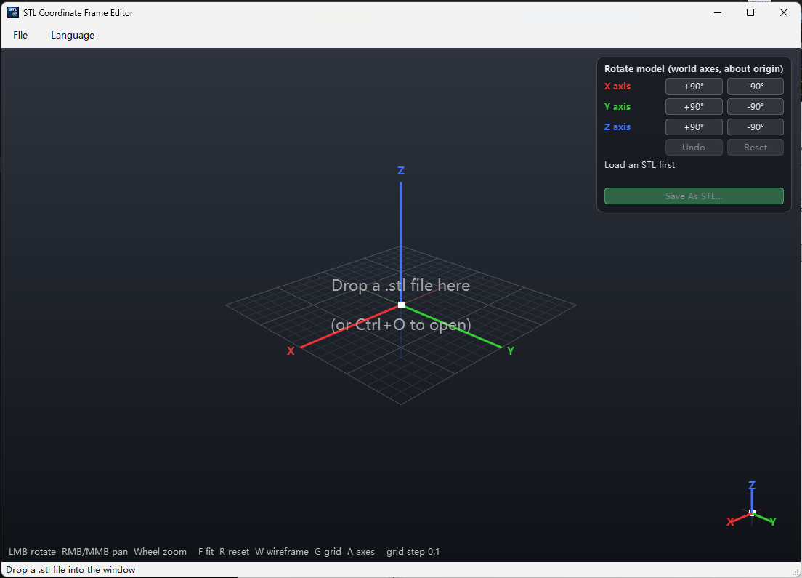

# STL Coordinate Frame Editor

**English** | [中文](README.zh.md)

Drag a `.stl` file into the window to view it, with a tri-color XYZ axis drawn at the origin.
The panel in the top-right rotates the model ±90° about the world X/Y/Z axes (about the origin, right-hand rule),
shows the accumulated rotation matrix and the equivalent URDF `rpy`, and **Save As STL** writes a new file
(the original is never touched). The menu bar supports switching between English and Chinese at runtime.

| Empty window (drop target) | STL loaded |
|---|---|
|  |  |

### Demo

https://private-user-images.githubusercontent.com/34444109/694237544-cf939573-5380-42bf-baad-11ce17f5d5cb.mp4

Dependencies: PySide6, PyOpenGL, numpy, trimesh, loguru.

## Download

Grab the latest `stl-frame-editor-vX.Y.Z-windows-x64.zip` from
[Releases](https://github.com/ccbs-tools/stl-frame-editor-release/releases), unzip anywhere and run
`stl-frame-editor.exe`. No installation required; `SHA256SUMS.txt` next to it lets you verify the download.

Requirements: Windows 10/11 x64.

## Run from source

Needs [uv](https://docs.astral.sh/uv/) (it will fetch Python itself):

```powershell
git clone https://github.com/ccbs-tools/stl-frame-editor.git
cd stl-frame-editor
uv sync
uv run python -m stl_frame_editor [xxx.stl]
```

## Controls

| Action | Description |
|------|------|
| Left drag | Rotate (turntable, Z up) |
| Right / Middle drag | Pan |
| Wheel | Zoom |
| `F` / `R` | Fit view / back to initial view |
| `W` / `G` / `A` | Toggle wireframe / ground grid / origin axes |
| `Ctrl+O` | Open file |

Red = X, Green = Y, Blue = Z. The small axis gizmo in the bottom-right always shows the current orientation.

## Package (onedir)

```powershell
uv sync --group dev
uv run pyinstaller main.spec --noconfirm
# Output: dist/stl-frame-editor/stl-frame-editor.exe, with dependencies alongside it
```

## Structure

```
stl_frame_editor/
  __main__.py         entry point main()
  main_window.py      main window, menus, app icon
  gl_widget.py        OpenGL viewport (grid / axes / camera / drag-drop)
  panel.py            top-right rotation panel
  mesh.py             STL loading, rotation matrix, rpy
  i18n.py             language strings and runtime switching
  log.py              loguru logging (%APPDATA%\ccbs\stl-frame-editor\logs\app.log)
  changelog.py        version history + update check
  version_dialogs.py  version info / update check dialogs
assets/               icon.ico / icon.png and README screenshots
run.py                PyInstaller entry
main.spec             PyInstaller config
```
