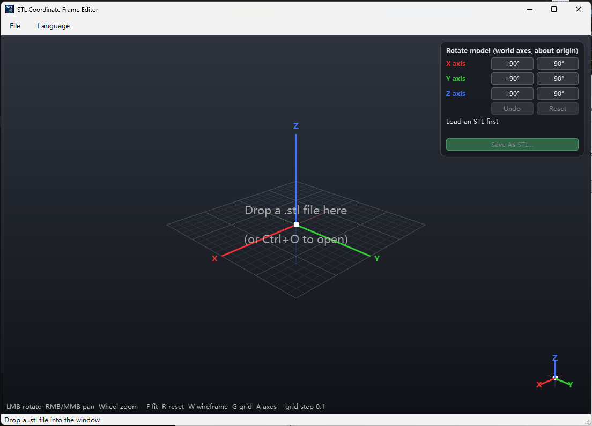
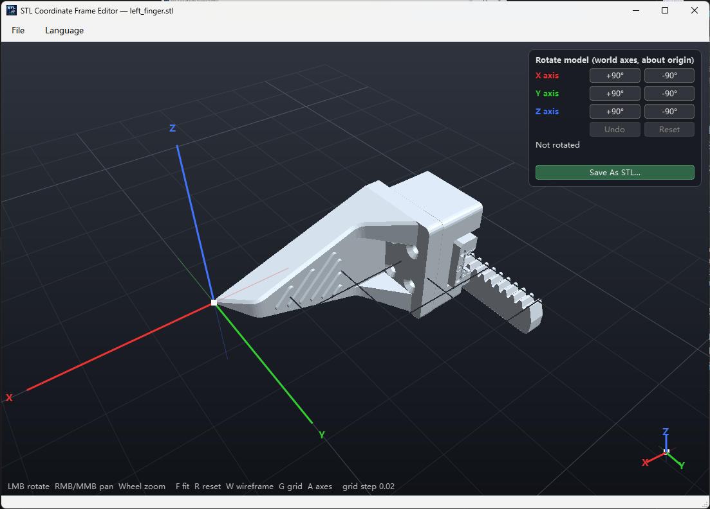

# STL 坐标系修改器（STL Coordinate Frame Editor）

[English](README.md) | **中文**

把 `.stl` 拖进窗口即可显示，原点处标注 XYZ 三色轴；右上角面板可把模型绕世界 X/Y/Z 轴转 ±90°（绕原点，右手定则），
显示累计旋转矩阵和等效 URDF `rpy`，"另存为 STL" 写出新文件（原文件不动）。菜单栏支持中英文实时切换。

| 空窗口（拖放区） | 已加载 STL |
|---|---|
|  |  |

### 演示

https://private-user-images.githubusercontent.com/34444109/694237544-cf939573-5380-42bf-baad-11ce17f5d5cb.mp4

依赖：PySide6、PyOpenGL、numpy、trimesh、loguru。

## 下载

到 [Releases](https://github.com/ccbs-tools/stl-frame-editor-release/releases) 下载最新的
`stl-frame-editor-vX.Y.Z-windows-x64.zip`，解压到任意位置运行 `stl-frame-editor.exe`。免安装；旁边的 `SHA256SUMS.txt` 可用来校验。

要求：Windows 10/11 x64。

## 源码运行

需要 [uv](https://docs.astral.sh/uv/)（会自动下载 Python）：

```powershell
git clone https://github.com/ccbs-tools/stl-frame-editor.git
cd stl-frame-editor
uv sync
uv run python -m stl_frame_editor [xxx.stl]
```

## 操作

| 操作 | 说明 |
|------|------|
| 左键拖动 | 旋转（转台式，Z 轴朝上） |
| 右键 / 中键 | 平移 |
| 滚轮 | 缩放 |
| `F` / `R` | 适配视角 / 回到初始视角 |
| `W` / `G` / `A` | 线框 / 地面网格 / 原点坐标轴 开关 |
| `Ctrl+O` | 打开文件 |

红 = X，绿 = Y，蓝 = Z。右下角小三轴始终显示当前朝向。

## 打包（onedir）

```powershell
uv sync --group dev
uv run pyinstaller main.spec --noconfirm
# 输出 dist/stl-frame-editor/stl-frame-editor.exe，依赖在同目录下
```

## 结构

```
stl_frame_editor/
  __main__.py         入口 main()
  main_window.py      主窗口、菜单、应用图标
  gl_widget.py        OpenGL 视口（网格 / 坐标轴 / 相机 / 拖放）
  panel.py            右上角旋转面板
  mesh.py             STL 读取、旋转矩阵、rpy
  i18n.py             多语言字符串与运行时切换
  log.py              loguru 日志（%APPDATA%\ccbs\stl-frame-editor\logs\app.log）
  changelog.py        版本历史 + 检查更新
  version_dialogs.py  版本介绍 / 检查更新对话框
assets/               icon.ico / icon.png 与 README 截图
run.py                PyInstaller 入口
main.spec             PyInstaller 配置
```
